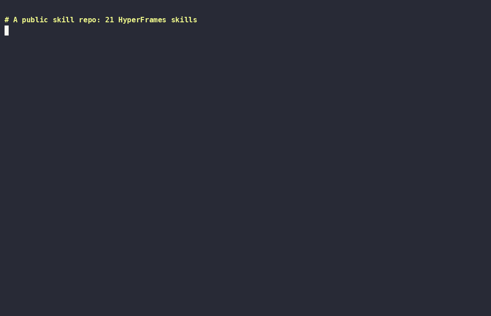

<div align="center">


# Girth

**Just-in-time, project-scoped agent skills.**<br>
Distil only the slice your project needs from the skills you already have — 38× lower always-on skill cost.

<p>
  <a href="https://github.com/mohessaid/girth/actions/workflows/ci.yml"></a>
  <a href="https://codecov.io/gh/mohessaid/girth"></a>
  <a href="https://github.com/mohessaid/girth/actions/workflows/codeql.yml"></a>
  <a href="https://scorecard.dev/viewer/?uri=github.com/mohessaid/girth"></a>
  <a href="https://github.com/mohessaid/girth/releases"></a>
  <a href="LICENSE"></a>
  <a href="Cargo.toml"></a>
  <a href="docs/mutation-notes.md"></a>
  <a href="docs/eval-log.md"></a>
  <a href="#install"></a>
</p>

<a href="#install">Install</a> · <a href="#how-it-works">How it works</a> · <a href="examples/hyperframes/RESULTS.md">Results</a> · <a href="CONTRIBUTING.md">Contributing</a>

</div>

Instead of installing dozens of large skills and paying for all of them every turn, Girth distils only the slice your project needs into a small `girth-<domain>` skill, at the moment you need it. Later sessions reuse it from the project's cache.

<p align="center"></p>

Status: v0.5, early and measured. Design: `docs/superpowers/specs/`.

Independent research points the same way: in [SkillsBench](https://arxiv.org/abs/2602.12670), focused skills improved task success by 18.9 points against 5.7 for comprehensive documentation, and 2–3 skills per task beat 4 or more.

## Measured so far (one machine)

**Five sessions in one domain** (2026-10-15, HyperFrames, claude-sonnet-5-5, the tasks never mention Girth):

| Arm | Session 1 | Sessions 2–5 (each) | 5-session total |
|---|---|---|---|
| Every skill installed (today's default) | $0.18 | $0.16–0.21 | $0.909 |
| Fresh distillation every session | $0.25 | $0.18–0.22 | $1.061 |
| **Girth (crafts once, then reuses)** | $0.22 | **$0.09–0.10** | **$0.599 (−34%)** |

Every session in every arm passed the HyperFrames check. See `examples/compounding/RESULTS.md`.

**Lens: the same task with and without Lens** (2026-10-15, the author's real setup of 74 skills and 6 MCP servers, claude-sonnet-5-5, 3 runs per arm):

| | Lens off | Skills Lens (v0.5) | Full Lens (v0.6) |
|---|---|---|---|
| Cost per run (mean) | $0.166 | $0.135 (−19%) | **$0.096 (−42%)** |
| Fresh prompt tokens (input + cache write) | 32.0K | 24.7K | **15.9K (−50%)** |
| Matching skill still invoked (collapsed by Lens) | 3/3 | 3/3 | 3/3 |
| Metadata checks passed | 18/18 | 18/18 | 18/18 |

With v0.6, tasks that need a collapsed MCP server still work, 6 of 6 across two servers: the server's instructions arrive on first use and Claude follows them.

See `examples/lens/RESULTS.md`, including the pilot that showed names alone lose a needed skill.

**SkillsBench, 6 tasks** (2026-10-15, claude-sonnet-5-5, one run per arm): Girth's one distilled skill per task **matched the task's curated skills on every task** (3/6 passed in each arm), with 23% fewer output tokens. Self-generated skills tend not to help (SkillsBench); skills distilled from curated sources kept their effect. See `examples/skillsbench/RESULTS.md`.

**One session, before and after crafting** (2026-10-14):

| | Before | With Girth (bulk skills removed) |
|---|---|---|
| Always-on skill cost (39 user skills vs crafted) | 17,022 B ≈ 4.3K tok | 448 B ≈ 112 tok (**38× less**) |
| Per-session new prompt tokens, HyperFrames task | 35.7K | 22.0K (**−38%**) |
| Task cost, same task and model | $0.181 | $0.149 (**−17%**) |
| HyperFrames check on the output | 1 warning | 0 warnings |

These are single runs. See `examples/hyperframes/RESULTS.md` for the full numbers and caveats, and `docs/eval-log.md` for the behavioural eval suite (7 cases, 21 runs, all 1.00).

## Install

**As a Claude Code plugin (recommended).** In Claude Code (2.1.275 or later):

```
/plugin marketplace add mohessaid/girth
/plugin install girth@girth
```

**As a plain skill, for any agent the [skills CLI](https://skills.sh) supports:**

```bash
npx skills add mohessaid/girth
```

| | Plugin | Skills CLI |
|---|---|---|
| Craft, reuse, `show`, `fetch`, `taste`, `made` | ✓ | ✓ |
| Usage ledger (`girth stats` knows which skills you actually use) | ✓ | crafts only |
| Taste delivered automatically when a domain skill loads | ✓ | ask *"girth taste &lt;domain&gt;"* |
| Lens and Meter (Claude Code 2.1.287 or later; MCP Lens and X-ray tested on 2.1.300) | ✓ | — |

The plugin registers a `PostToolUse` hook on skill loads (about 1 ms) and, on Claude Code 2.1.287 or later, a small mod (`hooks/girth.js`) for Lens and Meter. A skills-CLI install registers neither, so those parts are plugin-only.

**Updating.** Claude Code auto-updates only its official marketplaces. To keep Girth current, open `/plugin` → **Marketplaces** → `girth` → **Enable auto-update**, or run `claude plugin update girth@girth`. A session that's already open keeps the version it loaded until you run `/reload-plugins`. Your ledger and taste live in `~/.girth`, shared by every session and version.

You don't need Rust. The first time the skill runs, it downloads (one time, about 2 MB, with a timeout) the prebuilt `girth` binary for your platform from [Releases](https://github.com/mohessaid/girth/releases) and verifies it against `SHA256SUMS` before running it. Builds exist for Linux x86_64 and ARM64 (static musl) and macOS (Intel and Apple Silicon). To use your own build, set `GIRTH_BIN`.

## How it works

1. During a task, the model (or you: "use girth for …") names a need.
2. `girth search` ranks the skills already on disk and the project's crafted-skill cache, and `girth show` prints only the sections that matter. Nothing outside the project is read file by file.
3. If nothing local fits, `girth fetch owner/repo` makes a shallow, read-only copy of a public skill repo to search. Fetched content is treated as data and never executed.
4. The model distils only that slice into `.claude/skills/girth-<domain>/SKILL.md`. Rules are kept verbatim, tone guidance is never compressed, and the body is ≤ 3 KB.
5. `girth validate` enforces the contract. The next time the domain comes up, the crafted skill is a cache hit.

## Lens, X-ray & Meter

**Lens** trims what Claude Code adds to every request: the skill list, MCP server instructions and the deferred-tools list.
- **Kept in full:** the skills this project uses, skills you used anywhere in the last 30 days, skills installed in the last 14 days, your crafted `girth-*` skills, the project's own skills, and anything you pin.
- **Shortened:** every other skill collapses into one line, as its name plus a short hint, so it can still be found and invoked. Nothing is uninstalled and no settings change.
- **MCP servers** this project doesn't use (going by your tool calls) collapse to one line each. Their tools stay findable through ToolSearch. The first time Claude calls a collapsed server's tool, Girth hands it that server's instructions before the call runs, so nothing the server asks for is lost.
- **Settings:** pin skills (or server ids such as `claude_ai_Figma`) with `{"lens": {"keep": ["name"]}}` in `.girth/config.json` or `~/.girth/config.json`. Turn Lens off with `{"lens": {"enabled": false}}`, or with `GIRTH_LENS=off` for one session. `GIRTH_LENS_KINDS=skills` limits it to the skill list.
- **Limit:** on machines where an organization manages Claude Code, a plugin you install yourself can't rewrite the list, so Lens stays off there.

**X-ray:** run `/girth-xray` to see what your last request was made of, part by part, with each part's share, what Lens removed and what it costs. Tool parameter schemas aren't visible to plugins, so they aren't counted.

**Meter** records each turn's real token usage in your local ledger (numbers and a model id only). Run `/girth-meter` or `girth stats --meter` to see:
- your usage for the project;
- an estimated cost;
- how much Lens kept out of the prompt.

The estimate prices the main conversation's cache writes at the 1-hour rate Claude Code uses, and subagents' at the 5-minute rate they use. This reproduces Claude Code's own cost figure for the main conversation. It leaves out background requests, such as session titles. Meter data is never shared.

**Keeper** stops you paying twice for the same conversation.
- **The problem:** Claude Code caches your conversation for an hour. Come back later and the whole thing is written to the cache again, at twice the input price. On the author's machine, **62% of all cache writes** were these returns (`examples/cache/analyze-breaks.py` measures yours, locally).
- **What Girth does:** while a conversation sits idle, Girth sends a one-character ping (a fork of the conversation) every 55 minutes, at most 3 times (about 3¾ hours of cover). A ping reads the cache instead of writing it, at about 1/40 of the cost of a rewrite at API prices. If a ping finds the cache already gone, the pings stop.
  - On the author's history, this would have saved about $470 of rewrites for about $56 of pings.
  - On a subscription the saving is in plan usage rather than dollars. Girth can't verify that plans weigh cache reads and writes the way the API prices them.
- **Settings:** pings only happen for conversations of 20,000 tokens or more. Change that with `{"keeper": {"max_pings": 3, "min_context": 20000}}`. Turn it off with `{"keeper": {"enabled": false}}`, or `GIRTH_KEEPER=off` for one session.

**Doctor:** when a turn had to write the cache again, Girth says why under the answer, for example: `girth: the prompt cache had expired (idle 3h 12m); this turn re-wrote 450K tokens (≈ $3.60)`. `girth stats --meter` totals these rewrites and the keeper's pings.

**Idle compaction (opt-in)** makes the most expensive conversations cheaper to come back to.
- **The problem:** every request re-reads the whole conversation. On the author's machine, those re-reads were **62% of spend**, and the median request carried 387K tokens.
- **What Girth does:** when a conversation of at least 150,000 tokens has sat idle for 55 minutes, Girth compacts it (the same as `/compact`) while its cache is still warm. For that conversation, this replaces the keeper's pings.
  - You come back to a ~50K conversation instead of a ~580K one.
  - The first answer after your return says so, for example: `compacted this conversation while you were away (583K → 21K tokens)`.
  - On the author's history, this would have saved about $1.8K at API prices, including compactions of sessions never returned to (`examples/compact/analyze-idle-compaction.py` measures yours, locally).
- **The trade-off:** compaction keeps a summary, not every detail. That's why it stays off until you turn it on.
- **Settings:** turn it on with `{"compact": {"idle": true}}`, and change the threshold with `"min_context"`. `"idle": false` in any config file, or `GIRTH_COMPACT=off`, turns it off.
- **Interactive sessions only.** Claude Code doesn't let plugins compact `claude -p` or SDK sessions.

**Subagent model (opt-in):** `{"agents": {"model": "sonnet"}}` runs built-in subagents (general-purpose, Explore and the like) on that model. A model Claude or the agent's definition chose is kept, as are plugins' agents and forks. On the author's machine subagents were 6% of spend, so expect a modest saving. `/girth-meter` shows each turn's model.

## Ledger & feedback

Girth keeps a local, append-only ledger (`~/.girth/ledger.jsonl`) of which skills you use, which sections of which source skills your crafted skills keep or drop, and your 👍/👎. Ask *"girth stats"* to see which installed skills actually earn their place, or *"girth review captions"* to remove sections you don't want. Removals become signal too.

**Sharing is opt-in and anonymous.** Girth asks once. If you allow it, only **content hashes of public skill sections plus counts** (used / kept / removed / up / down) would be shared, never names, paths, text, notes or anything from your project. Nothing is uploaded until the Girth index launches. Run `girth share preview` to see exactly what would be sent.

## Taste memory

For the things you make again and again (launch videos, decks, landing pages), Girth remembers two things per domain:

- **House rules** you stated once: *"always end on the logo with the URL"*. They're applied every time, in every project, and a new or extra request never drops them.
- **What recent deliverables chose**: palette, music, opening and so on. The next one varies them unless a rule or your request pins them, and Girth tells you what's fresh.

With the plugin, taste arrives on its own. When a skill linked to the domain loads, Girth's hook adds the taste to context (about 1 ms; nothing is added for unrelated skills). Say *"from now on, always…"* to add a rule, or *"girth taste launch-video"* to see what's remembered.

Personal taste lives in `~/.girth/taste.jsonl` and follows you across projects. Project rules (`--project`) live in `.girth/taste.jsonl` and can be committed for a team; trust them as you trust that repo's `CLAUDE.md`. Taste is local only: `girth share` never reads it.

## CLI

```bash
cargo build --release
target/release/girth measure                      # what your skills cost in context
target/release/girth search "caption timing" --json
target/release/girth validate .claude/skills/girth-captions   # also records to the ledger
target/release/girth stats                                      # what the ledger says
target/release/girth share preview                              # exactly what would be shared
target/release/girth taste add launch-video "End on the logo with the URL."
target/release/girth made launch-video palette=paper-ink music=lo-fi
target/release/girth taste show launch-video                    # rules + recent choices
target/release/girth fetch obra/superpowers/skills              # shallow, untrusted, never executed
target/release/girth lens --project . < listing.txt             # what Lens would send for a skill listing
target/release/girth stats --meter --project .                  # token usage and Lens savings
```

Skill roots resolve in this order:
1. `--roots`
2. `GIRTH_SKILL_ROOTS` (colon-separated, POSIX style)
3. `.girth/config.json` (`{"roots": [...], "output": "..."}`)
4. The defaults: `~/.claude/skills`, `~/.agents/skills`, `.claude/skills`, and the `skills` folders of installed Claude Code plugins

## Development

```bash
make check    # fmt, clippy, tests (unit, property, CLI, launcher), coverage ≥ 90%, plugin validate, mod tests
make mutate   # cargo-mutants
make evals    # claude plugin eval on a staged dist copy (spends model credits, capped)
cargo deny check   # advisories, licenses, sources
```

See [CONTRIBUTING.md](CONTRIBUTING.md) and the [CHANGELOG](CHANGELOG.md). Report security issues privately ([SECURITY.md](SECURITY.md)).

Girth is built with Girth: see `examples/dogfood/RESULTS.md`.

## License

MIT
