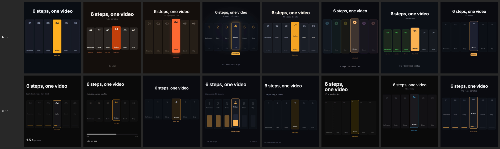

# Studio: the six-step video workflow, 8 runs per arm

**Date:** 2026-10-17 · **Model:** claude-sonnet-5-5 · **Runs:** 8 per arm, each a fresh project and a fresh session · **Grader:** a script (`grade.py`), not a model.



## Why this task

[@francescoinweb3's "AI production studio" post](https://x.com/francescoinweb3/status/2111190424647782538) (2026-10-16) makes videos with Claude in six steps, each one handing a file to the next: reference → data → story → motion → direct → ship. Its stack is the motion skills many people now install: HyperFrames, Remotion, GSAP and motion-design skills. This machine has 39 such skills installed. The task asks Claude to work that way, and to make a video *about* that way.

## Task (`task.md`)

A 9-second, 1080×1350, 30 fps HyperFrames video, "6 steps, one video". It has six labelled panels lit one at a time, 1.5 s each, with each step's output file under it.
- Claude must write `spec.md`, `data.json` (every number with a `source`), `story.md` and `timing.json` before animating.
- It must then pass `npx hyperframes check` and render `final.mp4`.

## Arms

Both arms run `claude -p --setting-sources project,local` with the girth plugin and an isolated `GIRTH_HOME` (`run.sh`). User-level skills, plugins and MCP servers are hidden in both, so the only difference is the project's `.claude/skills`:
- **bulk:** symlinks to all 39 skills in `~/.claude/skills`: 17,022 B always on (≈ 4,256 tok) and 3.66 MB of markdown behind them.
- **girth:** the one crafted `girth-studio` skill: 179 B always on (≈ 45 tok), 3.8 KB in total.

**Crafting (one-time, `craft.sh`):** $0.192, 11 turns.
- `girth search` ranked the 39 skills, and Girth read only the matched sections of four: `motion-graphics`, `explainer-beat-sheet`, `hyperframes-creative` and `hyperframes-cli`.
- Result: `crafted/girth-studio/SKILL.md` (3,814 B). It passes `girth validate`.
- The crafted skill was used as-is, even though some of its file names differ from the brief's (`FACTS.md` instead of `data.json`) and it says to ask before rendering. The brief overrides both, and every run followed the brief.

## Grade (`grade.py`, per run)

A run passes only if all of these hold:
1. `npx hyperframes check` exits 0.
2. `final.mp4` is 1080×1350 at 30 fps and 9 s (± 0.25 s).
3. `spec.md` and `story.md` are non-empty, `data.json` parses and carries `source` fields, and `timing.json` parses.
4. All six labels are in the composition.

## Results (`summarize.py --table runs`, mean ± 95% CI)

| Arm | Runs | Pass | Cost per run | Fresh input tok | Cache-read tok | Output tok |
|---|---|---|---|---|---|---|
| bulk | 8 | 8/8 | $0.206 ± $0.014 | 31,636 ± 1,963 | 267,789 ± 60,760 | 5,287 ± 313 |
| girth | 8 | 8/8 | **$0.146 ± $0.017** | **18,491 ± 1,985** | 177,424 ± 29,405 | 5,414 ± 699 |

- **Quality held:** 16/16 runs passed; every check had 0 errors and 0 warnings.
- **Cost fell 29%** ($0.206 → $0.146 per run; Welch's t = 6.4, df ≈ 13, p < 0.001). The 95% intervals don't overlap.
- **Fresh input fell 42%** (31.6K → 18.5K tokens; t = 11.1). That is the skill listing plus the skill bodies the bulk arm pulled in.
- **Output was the same** (5.3K vs 5.4K tokens). Girth didn't save by doing less.
- **Payback:** the $0.192 craft is recovered after about 3 sessions ($0.060 saved per session).

## Files
- `runs/<arm>-<n>.json`: the raw `claude -p` result.
  - Usage comes from `modelUsage`, which covers the whole session. The top-level `usage` and `num_turns` cover only the last turn, which is a short follow-up whenever a background task finishes after the answer.
- `runs/<arm>-<n>.grade.json`: the grade for each run.
- `outputs/bulk-1`, `outputs/girth-1`: one full project per arm (spec, data, story, timing, composition, `final.mp4`).
- `sheet.png`: every run's render at 5.25 s.

## Caveats
- **One task, one model, one machine.** The saving scales with how many skills are installed (39 here).
- **The grade is mechanical.** It shows that both arms meet the brief, not which video looks better. The sheet is there so you can judge that yourself.

## Reproduce
```sh
make dist
examples/studio/craft.sh                                   # once
examples/studio/run.sh bulk  /tmp/studio 1 8 &
examples/studio/run.sh girth /tmp/studio 1 8; wait          # STUDIO_MAX_USD caps each arm (default $6)
python3 examples/studio/summarize.py --table examples/studio/runs
```
